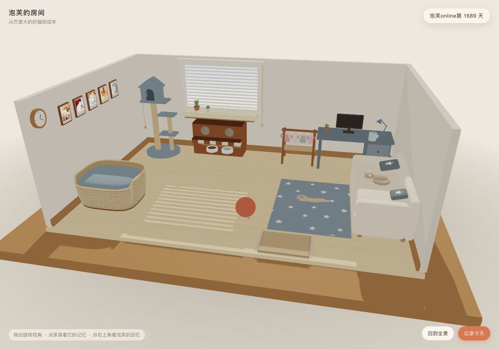
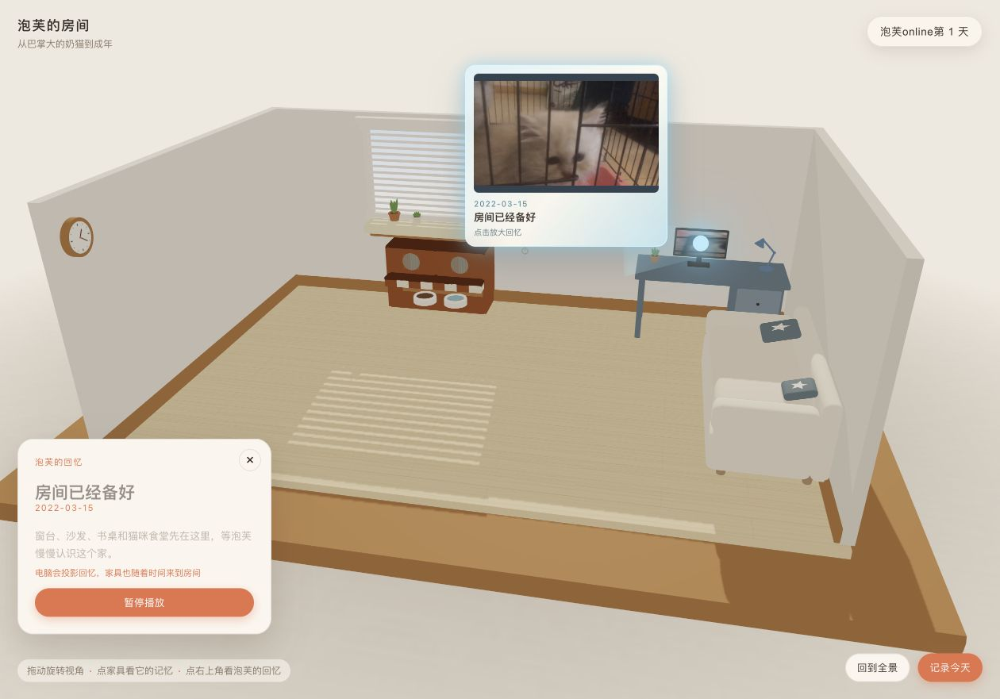

# 泡芙的房间

> 一个可以走进、回看和继续记录的 3D 猫咪成长房间。

泡芙从巴掌大的奶猫长到成年。这个项目把它生活过的房间做成一间可以探索的微缩空间：家具会随着时间留下痕迹，照片墙保存日常片段，电脑屏幕承接正在播放的回忆，房间本身就是一条可漫游的成长时间线。

## 在线体验

[打开泡芙的房间](http://127.0.0.1:8010/)

> 这是本机预览地址，页面由本地项目提供。

## 房间全景

房间采用暖白墙面、浅木地板和雾蓝软装，保留猫窝、猫碗、书桌、沙发、地毯、玩具和照片墙等生活痕迹。每件家具都不是孤立的模型，而是成长故事里的一个时间节点。

## 回忆正在发生

回忆播放时，空间会跟着日期变化：家具逐件出现，画面投向桌面电脑，记忆卡片与照片、视频一起展开。它更像一间可以回去走走的房间，而不是一组静态截图。

## 这个项目是什么

- 一间以泡芙为主角的 3D 记忆房间
- 一条从奶猫到成年猫的可视化成长时间线
- 一组由家具、照片、视频和空间关系组成的私人档案
- 一个把真实生活片段转成可探索场景的前端实验
